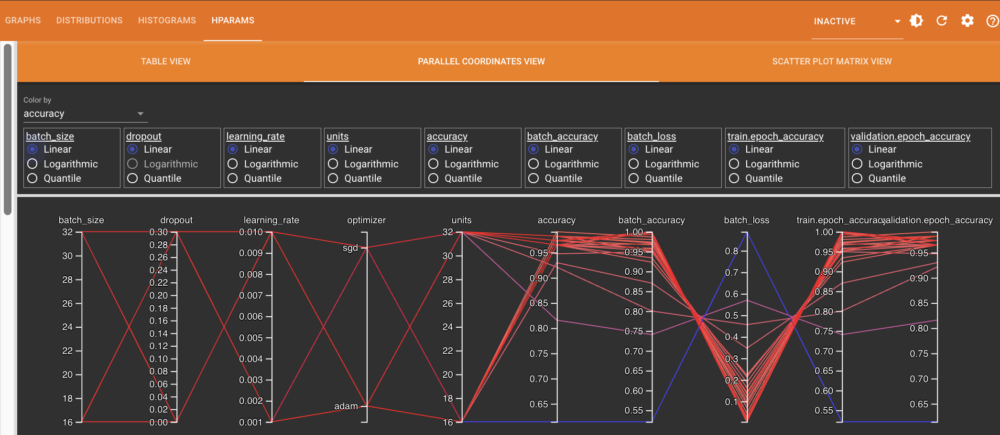
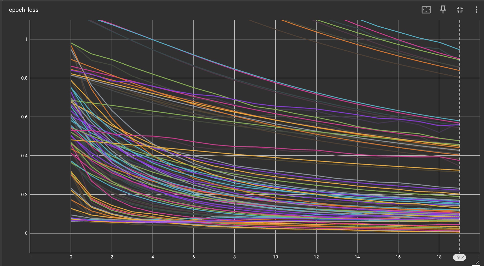
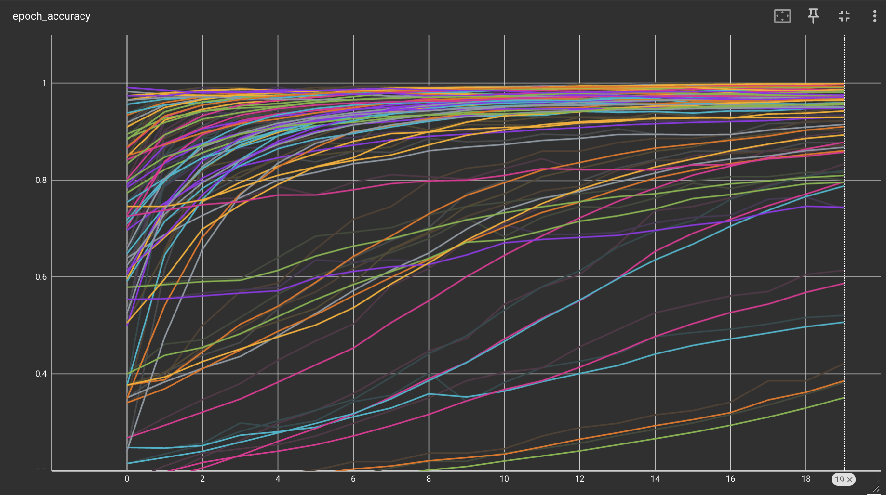
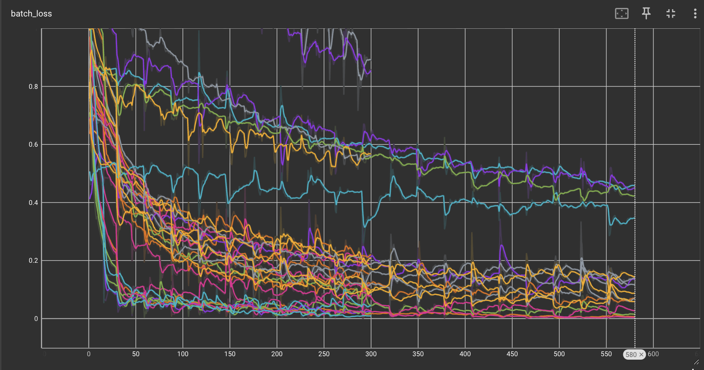
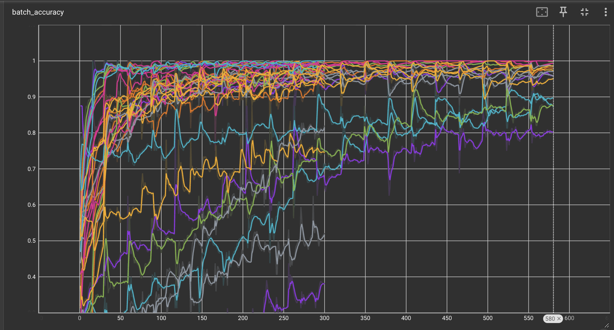
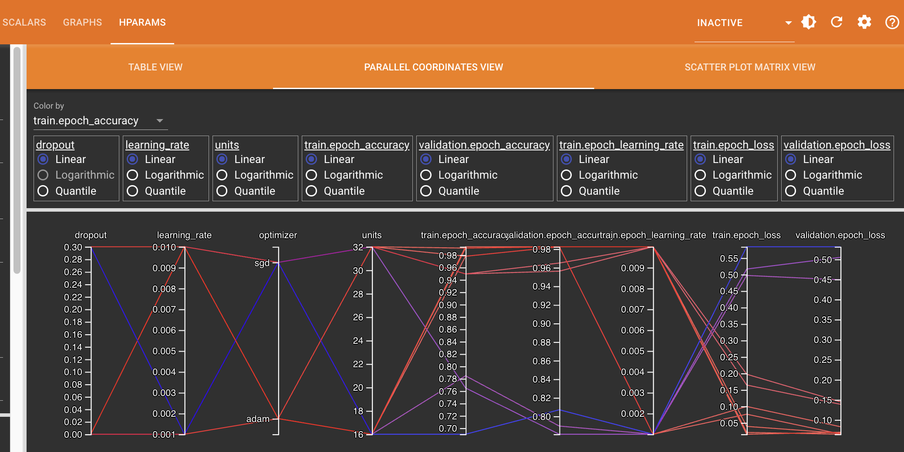
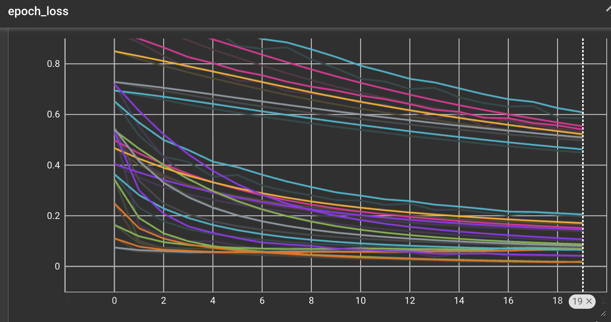
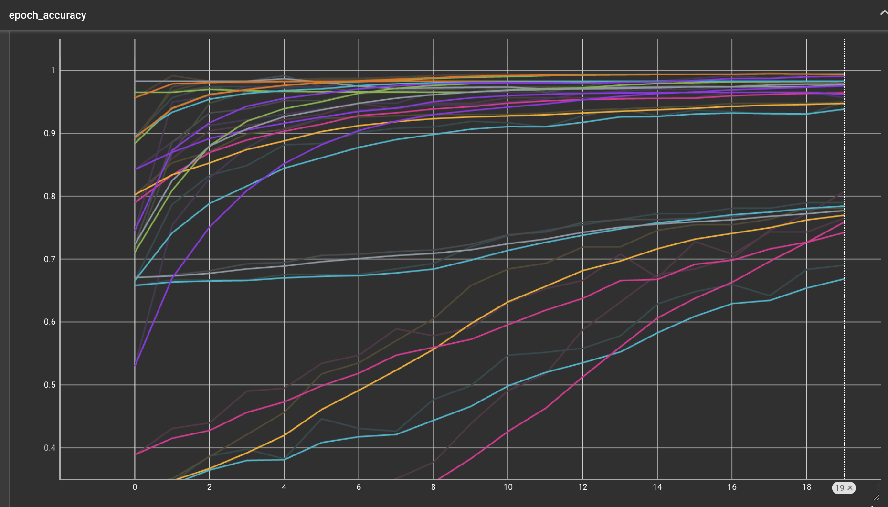

# Hyperparameter Optimization for Tabular Classification (Breast Cancer Dataset)

An experimental deep learning study evaluating **TensorBoard HParams Grid Search** vs. **Keras Tuner (`RandomSearch`)** on the **Breast Cancer Wisconsin (Diagnostic)** dataset (`569` samples, `30` numeric features, binary classification).

> **Author & Implementation Note:** All experimental code, hyperparameter search loops, TensorBoard logging, and overfitting/regularization analyses were authored and executed by **José Alberto Isidoro Sánchez**.

---

## Dataset & Preprocessing

- **Dataset:** `sklearn.datasets.load_breast_cancer` (`569` instances, `30` continuous features, binary target reshaped to `(samples, 1)`).
- **Split & Scaling:** `80/20` train/test split (`455` training samples, `114` test samples with `random_state=42`), standardized via `StandardScaler` fit on the training set and applied to the test set.
- **Base Network:** A dense neural network (`Input(30) -> Dense(units, ReLU) -> Dropout(rate) -> Dense(1, Sigmoid)`) compiled with `binary_crossentropy` and `accuracy`.

---

## Experimental Workflow

### Part A: Grid Search with TensorBoard HParams
- **Search Space:**
  - `learning_rate`: `[0.001, 0.01]`
  - `dropout`: `[0.0, 0.3]`
  - `optimizer`: `['adam', 'sgd']`
  - `batch_size`: `[16, 32]`
  - `units`: `[16, 32]`
- **Execution:** Exhaustive loop across all combinations (`2 x 2 x 2 x 2 x 2 = 32` runs) for `20` epochs per trial, logging scalar metrics, batch-level progress, and histograms to TensorBoard (`logs/hparam_tuning`).

#### Hyperparameter Overview & Epoch Trajectories
| Hyperparameter Parallel Coordinates | Epoch Loss | Epoch Accuracy |
| :---: | :---: | :---: |
|  |  |  |

#### Mini-Batch Convergence Diagnostics
| Batch Loss | Batch Accuracy |
| :---: | :---: |
|  |  |

### Part B: Automated Search with Keras Tuner (`RandomSearch`)
- **Search Configuration:** `keras_tuner.RandomSearch` optimizing `val_accuracy` across `max_trials=10` (`20` epochs, `batch_size=32`), tuning `units` (`16` to `32`, step `16`), `dropout` (`0.0` to `0.3`), `learning_rate` (`[0.001, 0.01]`), and `optimizer` (`['adam', 'sgd']`) with TensorBoard logging.
- **Best Trial Result:** Reached **`0.9912` validation accuracy** (`Trial 10` showed `0.9825` val accuracy), with top-performing configurations favoring **`units=32`**, **`learning_rate=0.01`**, and **`adam`**.

| Hyperparameter Parallel Coordinates | Epoch Loss | Epoch Accuracy |
| :---: | :---: | :---: |
|  |  |  |

---

## Key Findings: Overfitting, Regularization & Model Choice

- **Why dense networks fit tabular features cleanly here:** Unlike images where local pixel neighborhoods form spatial hierarchies, tabular diagnostic features do not have inherent 2D spatial neighbors—so a well-sized dense network is a natural fit without adding spatial inductive bias that can overfit small tabular datasets.
- **Dropout (`0.0` vs. `0.3`) & training duration:** Across `20` epochs on this dataset, `dropout=0.0` achieved top validation accuracy without needing heavy dropout, whereas comparing `dropout=0.3` against `0.0` helps check whether extra regularization narrows the train-vs.-validation gap on noisier runs.
- **How overfitting shows up:** Diverging curves—where training loss keeps dropping while validation loss plateaus or rises, or where training accuracy sits near `100%` with a noticeable drop on validation/test—signal memorization rather than generalization.
- **Grid Search vs. Keras Tuner:** Exhaustive grid search maps every combination systematically, while Keras Tuner streamlines searching and extracting best hyperparameters quickly.

---

## Repository Contents

- `breast_cancer_opt_with_keras_tensorflow.ipynb` — Complete TensorBoard grid search and Keras Tuner experiments.
- `assets/` — Exported TensorBoard parallel-coordinate, batch scalar, and epoch curve screenshots.
- `requirements.txt` & `.gitignore` — Environment dependencies and ignore rules for TensorBoard logs/cache.

---

## REPO STRUCTURE
```text
breast-cancer-nn-hyperparameter-tuning/
├── README.md
├── requirements.txt
├── .gitignore
├── breast_cancer_opt_with_keras_tensorflow.ipynb
└── assets/
    ├── grid_search_hparam_grid.png
    ├── grid_search_epoch_loss.png
    ├── grid_search_epoch_accuracy.png
    ├── grid_search_batch_loss.png
    ├── grid_search_batch_accuracy.png
    ├── keras_tuner_hparam_grid.png
    ├── keras_tuner_epoch_loss.png
    └── keras_tuner_epoch_accuracy.png
```

---


